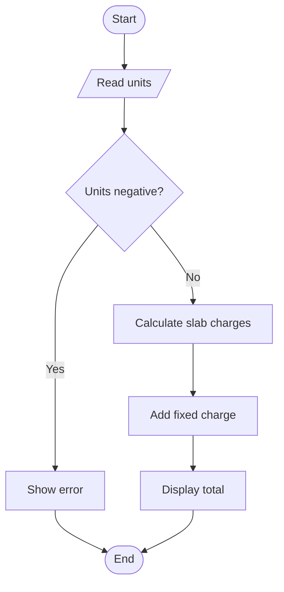

# Case Study 2: Progressive Electricity Billing

## Problem statement
Calculate a household electricity bill using progressive consumption slabs, a fixed charge, and validate the input.

## Objectives
- Apply progressive tariff slabs.
- Reject negative consumption.
- Display itemized charges and total.

## Assumptions
Sample rates: first 100 units at Rs. 1.50/unit; next 100 at Rs. 2.50; next 100 at Rs. 4.00; remaining units at Rs. 6.00. Fixed charge is Rs. 50. These are demonstration values only.

## Algorithm
1. Read units. 2. Reject negative units. 3. Calculate each slab charge. 4. Add fixed charge. 5. Display charges.

## Flowchart


## Pseudocode
```text
INPUT units
IF units < 0: DISPLAY error
ELSE: calculate progressive slabs; add fixed charge; DISPLAY bill
```

## Source code
See `main.py`.

## Test cases
- Input `0` → total Rs. 50.00
- Input `100` → total Rs. 200.00
- Input `250` → total Rs. 650.00
- Input `-2` → error message

## Conclusion
The program demonstrates arithmetic, conditions, and progressive slab calculations.