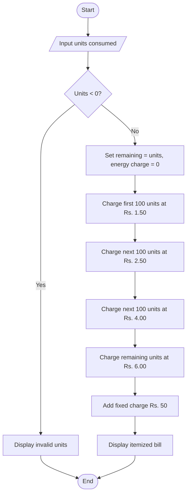

# Case Study 2: Progressive Electricity Billing

## 1. Problem statement
Write a Python program to calculate a household electricity bill using progressive unit slabs. The program must reject negative unit consumption and display the energy charge, fixed charge, and total bill.

## 2. Objectives
- Read numeric input from the user.
- Use arithmetic operators to calculate charges.
- Apply conditional statements to validate input.
- Use progressive slabs to calculate the energy charge.
- Display the bill in a clear, itemized format.

## 3. Assumptions
These are sample values for the assignment and can be changed if the lecturer gives different rates.

| Consumption slab | Rate |
|---|---:|
| First 100 units | Rs. 1.50 per unit |
| Next 100 units (101–200) | Rs. 2.50 per unit |
| Next 100 units (201–300) | Rs. 4.00 per unit |
| Above 300 units | Rs. 6.00 per unit |
| Fixed charge | Rs. 50.00 per bill |

The rate applies only to the units inside that slab. For example, 250 units means 100 units at Rs. 1.50, 100 units at Rs. 2.50, and 50 units at Rs. 4.00.

## 4. Algorithm
1. Start.
2. Read the number of units consumed.
3. If units are less than zero, display an error message and stop.
4. Set remaining units equal to the entered units and energy charge to zero.
5. Calculate the charge for up to the first 100 units; subtract those units from remaining units.
6. Repeat for the next 100 units at Rs. 2.50 and the next 100 units at Rs. 4.00.
7. If any units remain, charge them at Rs. 6.00 per unit.
8. Add the fixed charge of Rs. 50.00.
9. Display the energy charge, fixed charge, and total bill.
10. Stop.

## 5. Flowchart


## 6. Pseudocode
```text
START
INPUT units
IF units < 0
    DISPLAY "Units cannot be negative."
ELSE
    remaining = units
    energy_charge = 0

    slab = smaller of remaining and 100
    energy_charge = energy_charge + slab * 1.50
    remaining = remaining - slab

    slab = smaller of remaining and 100
    energy_charge = energy_charge + slab * 2.50
    remaining = remaining - slab

    slab = smaller of remaining and 100
    energy_charge = energy_charge + slab * 4.00
    remaining = remaining - slab

    IF remaining > 0
        energy_charge = energy_charge + remaining * 6.00

    fixed_charge = 50
    total_bill = energy_charge + fixed_charge
    DISPLAY energy_charge, fixed_charge, total_bill
END
```

## 7. Python source code
The complete source code is in [main.py](main.py). Run it with `python main.py` from this folder.

## 8. Test cases

| Input units | Expected energy charge | Fixed charge | Expected total |
|---:|---:|---:|---:|
| 0 | Rs. 0.00 | Rs. 50.00 | Rs. 50.00 |
| 100 | Rs. 150.00 | Rs. 50.00 | Rs. 200.00 |
| 150 | Rs. 275.00 | Rs. 50.00 | Rs. 325.00 |
| 250 | Rs. 600.00 | Rs. 50.00 | Rs. 650.00 |
| 350 | Rs. 1,100.00 | Rs. 50.00 | Rs. 1,150.00 |
| -2 | Error message | — | No bill calculated |

## 9. Sample output
For input `250`, the program should display:
```text
Enter units consumed: 250
Energy charge: Rs. 600.00
Fixed charge: Rs. 50.00
Total bill: Rs. 650.00
```

For negative input:
```text
Enter units consumed: -2
Units cannot be negative.
```

## 10. Output screenshot
After running the program on your computer, capture a screenshot showing the terminal input and output. Save the genuine screenshot in this folder as `output-screenshot.png`. Do not use the sample output above as if it were a screenshot.

## 11. Conclusion
This case study demonstrates variables, numeric input, arithmetic operators, conditional statements, and progressive slab calculations. It also shows how input validation prevents a negative consumption value from being billed.
