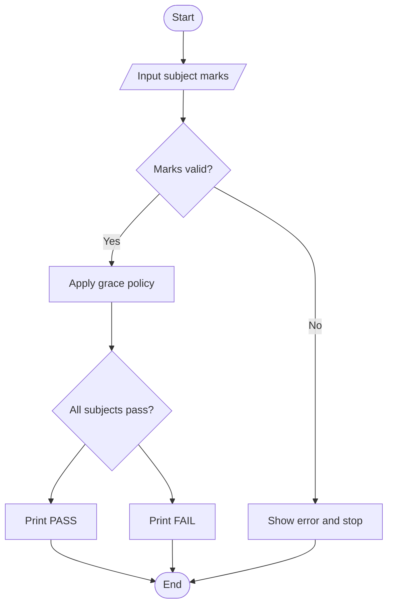
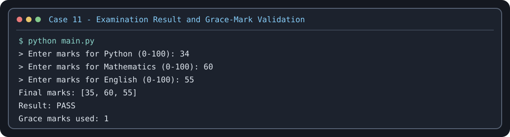

# Case Study 11: Examination Result and Grace-Mark Validation

## Problem statement
Evaluate marks in three subjects, apply a limited grace-mark policy, and determine the result without exceeding maximum marks.

## Objectives
Validate marks, apply grace marks only to small shortfalls, and report the final result.

## Assumptions
Three subjects; pass mark 35/100; at most 5 total grace marks. This is a sample policy, not an official college rule.

## Algorithm
Read and validate each mark; store marks in a list; check each shortfall; use grace marks within the total limit; print final marks and result.

## Flowchart


## Pseudocode
```text
INPUT each subject mark
VALIDATE marks
FOR each mark: apply allowed grace if eligible
DISPLAY final marks
IF all final marks >= pass mark: DISPLAY PASS ELSE DISPLAY FAIL
```

## Test cases
- `35, 40, 70` → PASS, 0 grace marks
- `32, 40, 70` → PASS, 3 grace marks
- `20, 40, 70` → FAIL
- Any mark above 100 or below 0 → invalid input

## Conclusion
This program uses lists, loops, conditions, and basic validation.

## Execution output capture



Test scenarios: [TEST_CASES.md](TEST_CASES.md). The image is a terminal-style rendering of a representative sample run; run `python main.py` locally to capture a native IDE/terminal screenshot if your instructor requires one.
