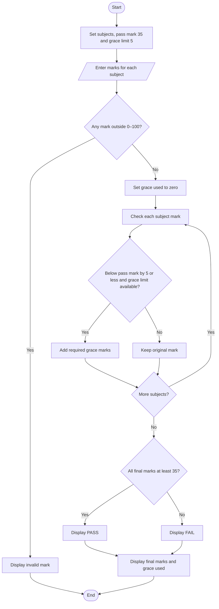

# Flowchart — Examination Result and Grace-Mark Validation

This flowchart follows the validation, grace-mark limit, and result logic in `main.py`.

**Key:** Oval = Start/End · Parallelogram = Input/Output · Diamond = Decision · Rectangle = Process
