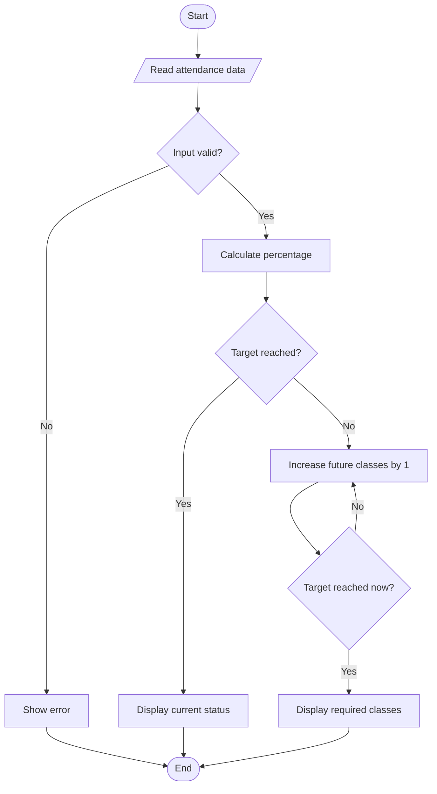

# Case Study 12: Attendance Recovery Computation

## Problem statement
Calculate current attendance and the minimum number of future classes a student must attend consecutively to reach a required percentage.

## Objectives
Compute attendance percentage, validate input, and use a loop to find the minimum number of classes needed.

## Assumptions
Future classes are all attended. The required threshold is entered by the user.

## Algorithm
Read attended classes, conducted classes, and threshold; validate values; calculate percentage; if below threshold, increase future attended classes one by one until the target is reached.

## Flowchart


## Pseudocode
```text
READ attended, conducted, target
VALIDATE inputs
percentage = attended / conducted * 100
extra = 0
WHILE future attendance is below target: extra = extra + 1
DISPLAY percentage and extra
```

## Test cases
- Attended 80, conducted 100, target 75 → already eligible
- Attended 60, conducted 100, target 75 → 60 consecutive classes
- Attended greater than conducted → invalid input

## Conclusion
The program demonstrates percentages, validation, and while loops.