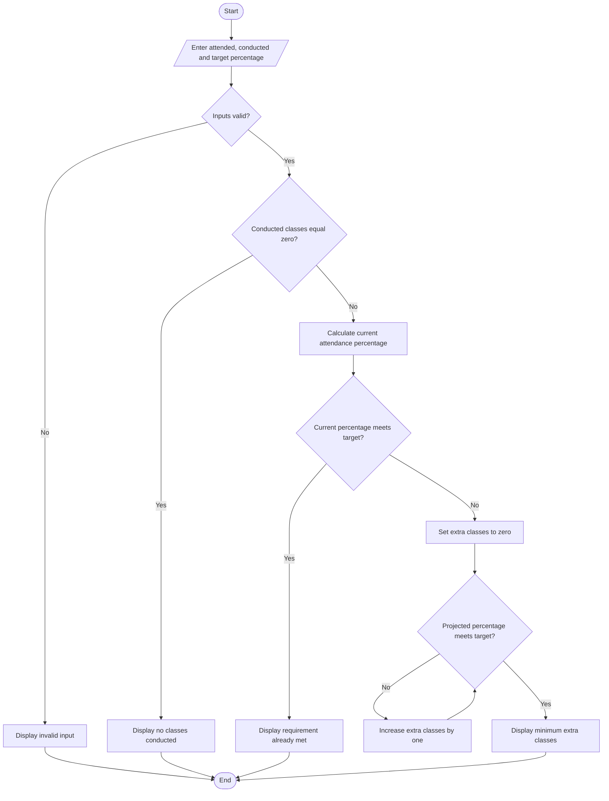

# Flowchart — Attendance Recovery Computation

This flowchart follows the input checks and consecutive-attendance loop in `main.py`.

**Key:** Oval = Start/End · Parallelogram = Input/Output · Diamond = Decision · Rectangle = Process
