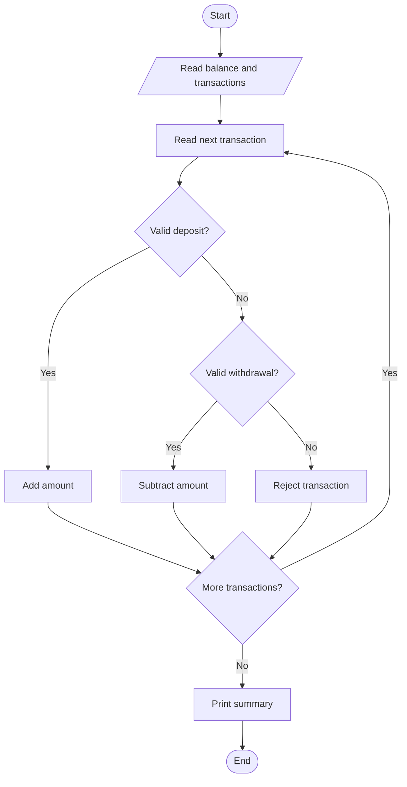
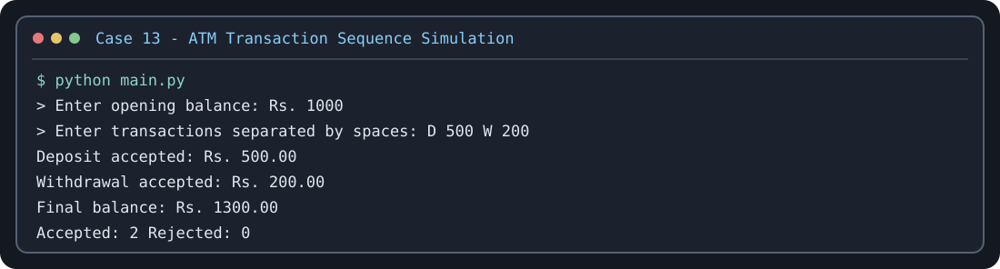

# Case Study 13: ATM Transaction Sequence Simulation

## Problem statement
Process deposits and withdrawals, update an account balance, reject invalid transactions, and summarize results.

## Objectives
Practice loops, conditions, string input, numeric conversion, and balance updates.

## Assumptions
Transactions are entered as pairs separated by spaces: `D amount` for deposit and `W amount` for withdrawal. Maximum withdrawal is Rs. 10,000 per transaction.

## Algorithm
Read opening balance; read transaction pairs; validate each amount and type; update balance for accepted transactions; count accepted and rejected transactions; print summary.

## Flowchart


## Pseudocode
```text
READ opening balance and transaction list
FOR each transaction pair
  VALIDATE type and amount
  IF valid deposit: add amount
  ELSE IF valid withdrawal and within limits: subtract amount
  ELSE reject
DISPLAY final balance and counts
```

## Test cases
- Opening 1000, transactions `D 500 W 200` → final balance Rs. 1300
- Opening 100, transaction `W 200` → rejected, balance Rs. 100
- Negative amount → rejected

## Conclusion
This simulation demonstrates sequence processing, loops, conditions, and validation.

## Execution output capture



Test scenarios: [TEST_CASES.md](TEST_CASES.md). The image is a terminal-style rendering of a representative sample run; run `python main.py` locally to capture a native IDE/terminal screenshot if your instructor requires one.
