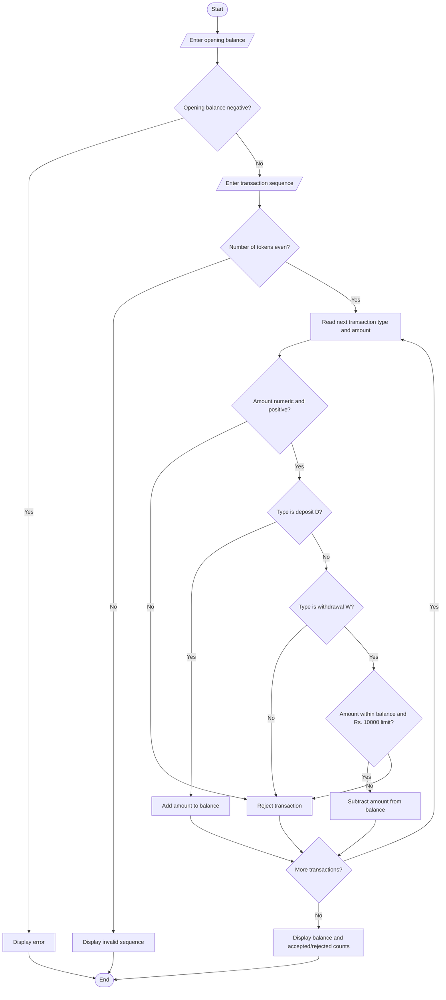

# Flowchart — ATM Transaction Sequence Simulation

This flowchart follows the deposit, withdrawal, and rejection logic in `main.py`.

**Key:** Oval = Start/End · Parallelogram = Input/Output · Diamond = Decision · Rectangle = Process
