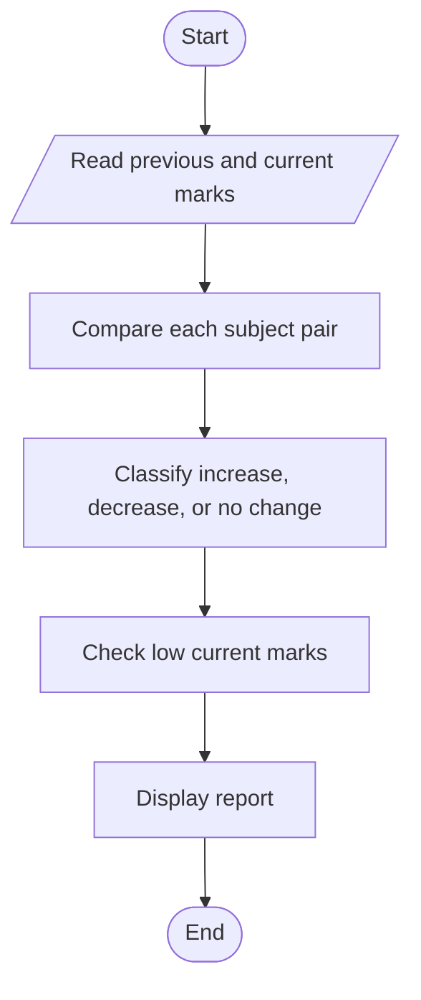

# Case Study 17: Student Performance Trend Analysis

## Problem statement
Compare marks from two examinations, identify improvements or declines, and list subjects with low current marks.

## Objectives
Store marks in lists, compare corresponding values, and report trends.

## Assumptions
Three sample subjects are used. A current mark below 40 is considered a subject needing attention.

## Algorithm
Read previous marks; read current marks; compare each pair; print the change and trend; identify current marks below 40.

## Flowchart


## Pseudocode
```text
READ previous marks and current marks
FOR each subject
  change = current - previous
  DISPLAY trend
  IF current < 40: add subject to weak list
DISPLAY weak list
```

## Test cases
- Previous `[60, 50, 70]`, current `[70, 45, 70]` → Python improved, Mathematics declined, English unchanged
- Current mark 30 → subject listed as needing attention

## Conclusion
The program demonstrates lists, loops, comparisons, and trend analysis.