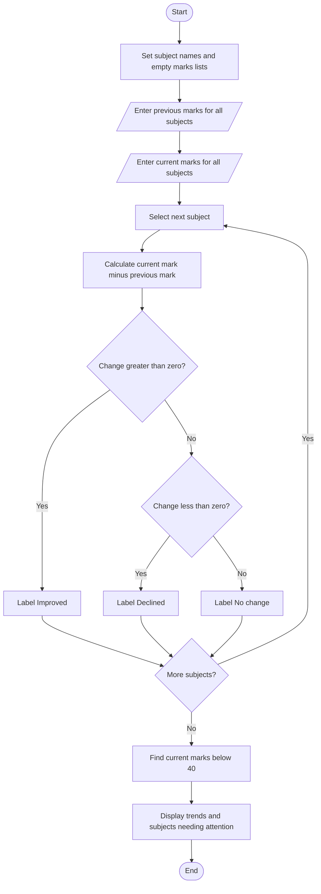

# Flowchart — Student Performance Trend Analysis

This flowchart follows the previous/current marks comparison in `main.py`.

**Key:** Oval = Start/End · Parallelogram = Input/Output · Diamond = Decision · Rectangle = Process
