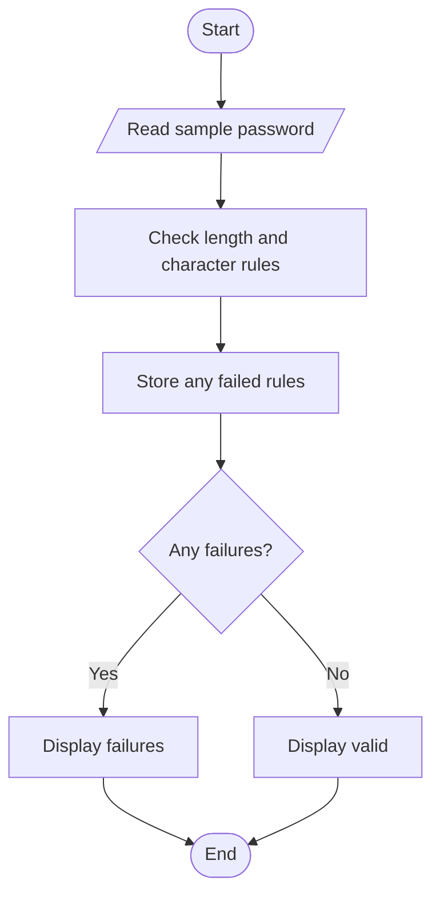

# Case Study 29: Password Policy Validation Engine

## Problem statement
Check a sample password against length, character-category, and prohibited-word rules, and explain any failed conditions.

## Objectives
Use strings, loops, conditions, and a list of validation messages.

## Assumptions
A valid sample password has at least 8 characters, one lowercase letter, one uppercase letter, one digit, one special character, and does not contain the word `password` (case-insensitive). Do not use a real personal password for this classroom exercise.

## Algorithm
Read sample text; check each policy rule; store each failure; print all failures or a success message.

## Flowchart


## Pseudocode
```text
READ sample password
CHECK every rule and record failures
IF failures exist: DISPLAY failures
ELSE: DISPLAY policy passed
```

## Test cases
- `Abcdef1!` → meets the sample policy
- `hello` → fails multiple rules
- `Password123!` → fails prohibited-word rule

## Conclusion
This program demonstrates string methods, iteration, conditions, and lists.