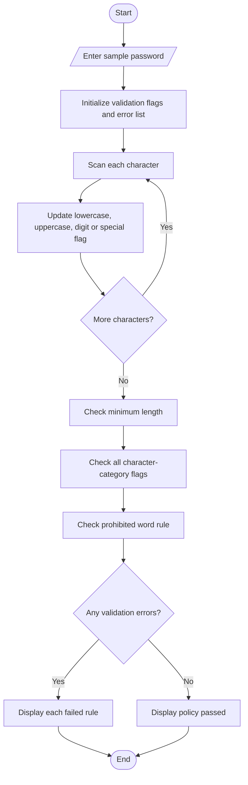

# Flowchart — Password Policy Validation Engine

Use a made-up sample password for this classroom exercise, not a personal password.

**Key:** Oval = Start/End · Parallelogram = Input/Output · Diamond = Decision · Rectangle = Process
