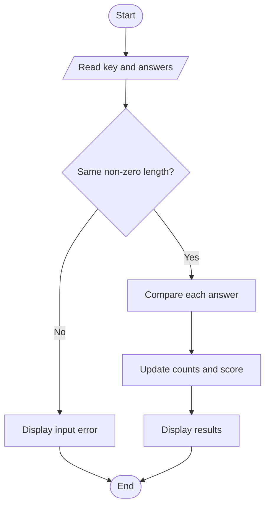
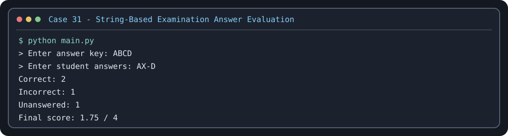

# Case Study 31: String-Based Examination Answer Evaluation

## Problem statement
Compare student answer strings against an answer key, count correct, incorrect, and unanswered questions, and apply negative marking.

## Objectives
Use strings, indexing, loops, conditions, and arithmetic.

## Assumptions
Each character represents one answer. `-` means unanswered. Correct answer = +1, incorrect answer = -0.25, unanswered = 0.

## Algorithm
Read key and answers; remove spaces and convert to uppercase; validate equal lengths; compare each character; update counts and score; display results.

## Flowchart


## Pseudocode
```text
READ key and answers
IF lengths differ: DISPLAY error
ELSE FOR each position
  IF answer is blank: count unanswered
  ELSE IF answer equals key: add 1
  ELSE subtract 0.25
DISPLAY counts and score
```

## Test cases
- Key `ABCD`, answers `AB-D` → 3 correct, 0 incorrect, 1 unanswered, score 3.00
- Key `ABC`, answers `ADC` → 2 correct, 1 incorrect, score 1.75
- Different string lengths → input error

## Conclusion
The program demonstrates string processing, indexing, loops, and scoring.

## Execution output capture



Test scenarios: [TEST_CASES.md](TEST_CASES.md). The image is a terminal-style rendering of a representative sample run; run `python main.py` locally to capture a native IDE/terminal screenshot if your instructor requires one.
