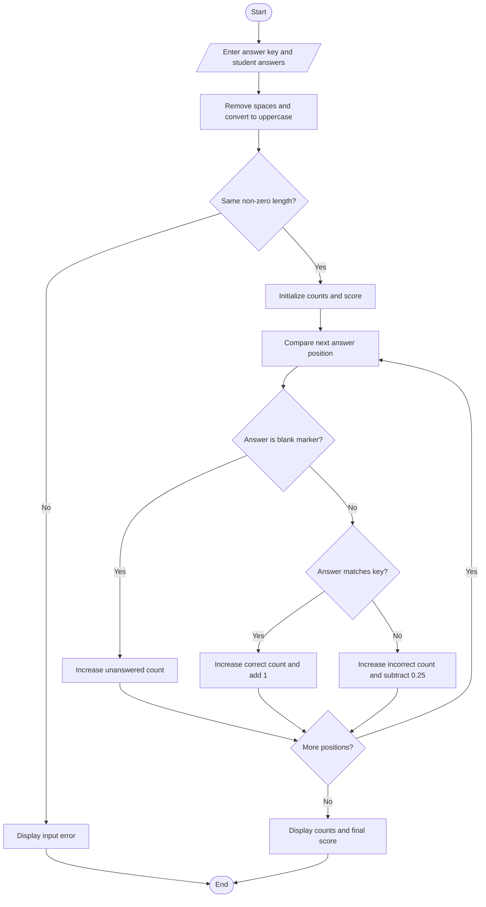

# Flowchart — String-Based Examination Answer Evaluation

This flowchart follows the answer comparison and negative-marking logic in `main.py`.

**Key:** Oval = Start/End · Parallelogram = Input/Output · Diamond = Decision · Rectangle = Process
