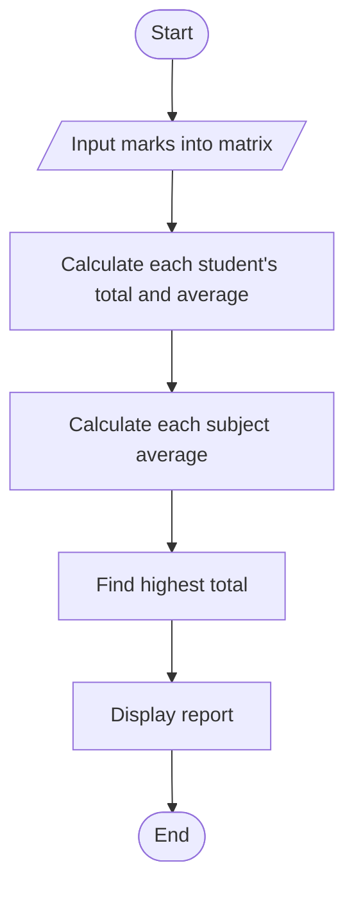
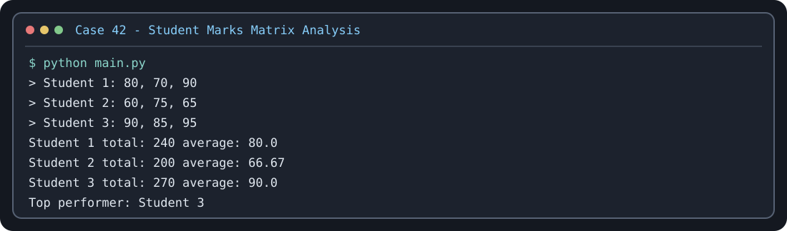

# Case Study 42: Student Marks Matrix Analysis

## Problem statement
Store marks for multiple students and subjects in a nested list, calculate student totals and averages, subject averages, and identify the top performer.

## Objectives
Practice nested lists, nested loops, indexing, and arithmetic.

## Assumptions
There are three sample students and three subjects. Marks must be from 0 to 100.

## Algorithm
Read marks into a nested list; calculate each row total and average; calculate each subject-column average; find the student with the highest total; display the report.

## Flowchart


## Pseudocode
```text
FOR each student: read marks for each subject into nested list
FOR each row: calculate total and average
FOR each subject column: calculate average
FIND student with highest total
DISPLAY results
```

## Test cases
Enter rows `[80, 70, 90]`, `[60, 75, 65]`, `[90, 85, 95]` → Student 3 is top performer; totals are 240, 200, and 270.

## Conclusion
The program demonstrates nested lists, nested loops, row-wise and column-wise calculations.

## Execution output capture



Test scenarios: [TEST_CASES.md](TEST_CASES.md). The image is a terminal-style rendering of a representative sample run; run `python main.py` locally to capture a native IDE/terminal screenshot if your instructor requires one.
