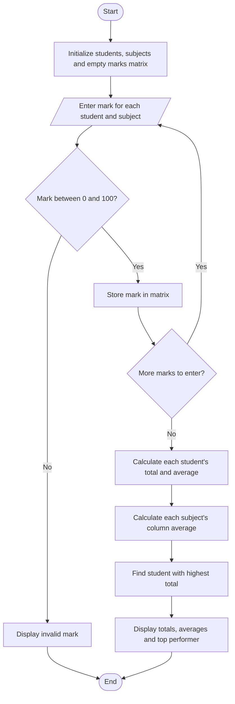

# Flowchart — Student Marks Matrix Analysis

This flowchart follows the matrix input, row/column calculations, and top-performer search in `main.py`.

**Key:** Oval = Start/End · Parallelogram = Input/Output · Diamond = Decision · Rectangle = Process
