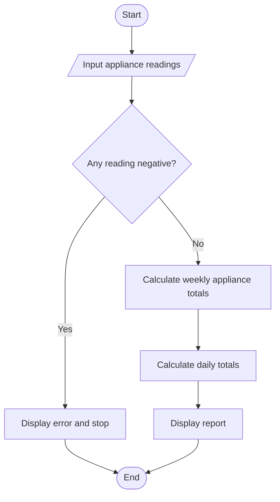

# Case Study 45: Weekly Electricity Consumption Matrix

## Problem statement
Store appliance-wise electricity readings for seven days, calculate weekly totals per appliance and daily totals, and flag invalid negative readings.

## Objectives
Use nested lists, nested loops, indexing, and summation.

## Assumptions
Three example appliances and seven days are used. The user enters daily units consumed; all values must be non-negative.

## Algorithm
Read seven daily readings for each appliance into a nested list; calculate each appliance's weekly total; calculate each day's total across appliances; display totals.

## Flowchart


## Pseudocode
```text
FOR each appliance
  FOR each day: READ units and store in matrix
FOR each appliance: DISPLAY row sum
FOR each day: DISPLAY column sum
```

## Test cases
If one appliance uses 1 unit every day, its weekly total is 7 units. If all three appliances use 1 unit on Monday, Monday total is 3 units.

## Conclusion
The program demonstrates nested lists and row-wise and column-wise totals.