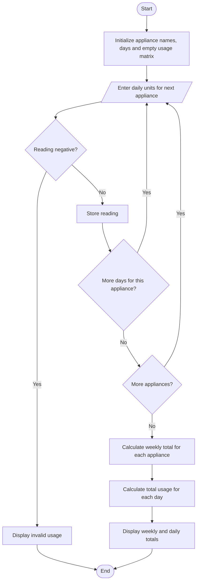

# Flowchart — Weekly Electricity Consumption Matrix

This flowchart follows the appliance/day matrix input and row/column totals in `main.py`.

**Key:** Oval = Start/End · Parallelogram = Input/Output · Diamond = Decision · Rectangle = Process
