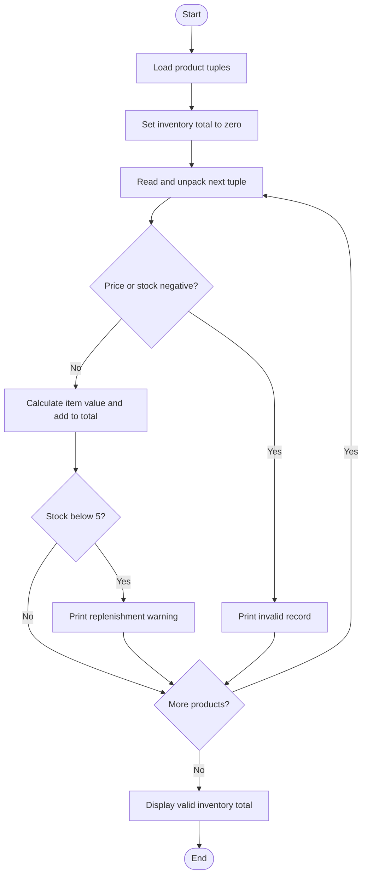
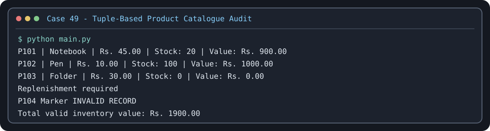

# Case Study 49: Tuple-Based Product Catalogue Audit

## Problem statement
Audit a small product catalogue stored as tuples. Identify invalid product records, calculate valid inventory values, and flag items with low stock.

## Objectives
- Store records as tuples inside a list.
- Unpack tuple values into variables.
- Use conditions and loops to validate records.
- Calculate stock value using price × quantity.

## Assumptions
Each record contains product ID, product name, unit price, and stock quantity. A negative price or stock quantity makes a record invalid. Valid records with fewer than 5 units in stock are flagged for replenishment. The sample catalogue is included in `main.py`.

## Algorithm
1. Store product records as tuples in a list.
2. Set total valid inventory value to zero.
3. Visit each product tuple and unpack its fields.
4. If price or stock is negative, print an invalid-record message.
5. Otherwise calculate price × stock and add it to the total.
6. If stock is below 5, print a replenishment warning.
7. Display the total valid inventory value.

## Flowchart


## Pseudocode
```text
products = list of product tuples
total = 0
FOR each product tuple
    UNPACK product ID, name, price, stock
    IF price < 0 OR stock < 0
        DISPLAY invalid record
    ELSE
        value = price * stock
        total = total + value
        DISPLAY product details and value
        IF stock < 5
            DISPLAY replenishment required
DISPLAY total
```

## Test cases
- A valid product with price Rs. 10 and stock 4 should have value Rs. 40 and show a replenishment warning.
- A product with stock 0 should have value Rs. 0 and show a replenishment warning.
- A product with a negative price should be marked invalid and excluded from the total.
- The sample data should produce a valid inventory total of Rs. 1,900.00.

## Sample output
```text
Product catalogue audit
P101 | Notebook | Rs. 45.00 | Stock: 20 | Value: Rs. 900.00
P102 | Pen | Rs. 10.00 | Stock: 100 | Value: Rs. 1000.00
P103 | Folder | Rs. 30.00 | Stock: 0 | Value: Rs. 0.00
  Replenishment required
P104 Marker INVALID RECORD
Total valid inventory value: Rs. 1900.00
```

## Conclusion
The program demonstrates tuples, tuple unpacking, lists, loops, conditions, and arithmetic calculations for a simple catalogue audit.

## Execution output capture



Test scenarios: [TEST_CASES.md](TEST_CASES.md). The image is a terminal-style rendering of a representative sample run; run `python main.py` locally to capture a native IDE/terminal screenshot if your instructor requires one.
