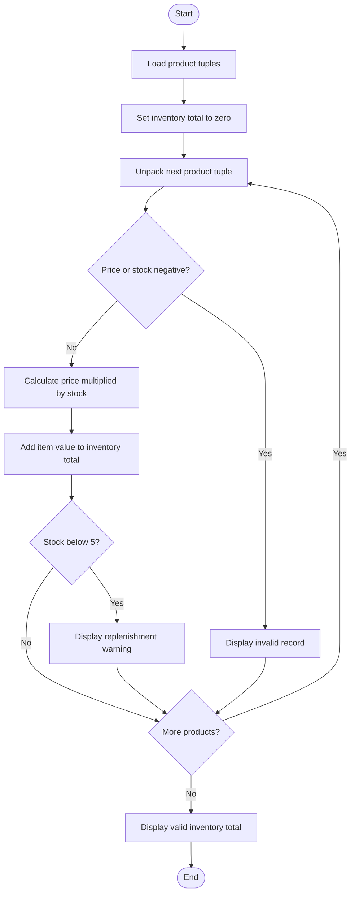

# Flowchart — Tuple-Based Product Catalogue Audit

This flowchart follows the tuple validation, inventory valuation, and low-stock check in `main.py`.

**Key:** Oval = Start/End · Parallelogram = Input/Output · Diamond = Decision · Rectangle = Process
